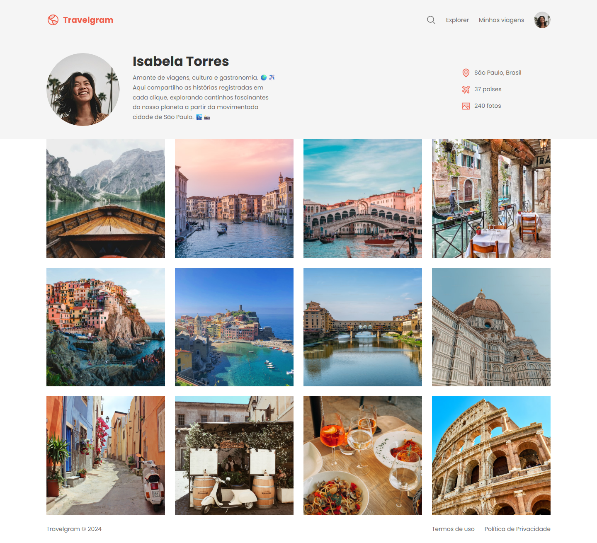
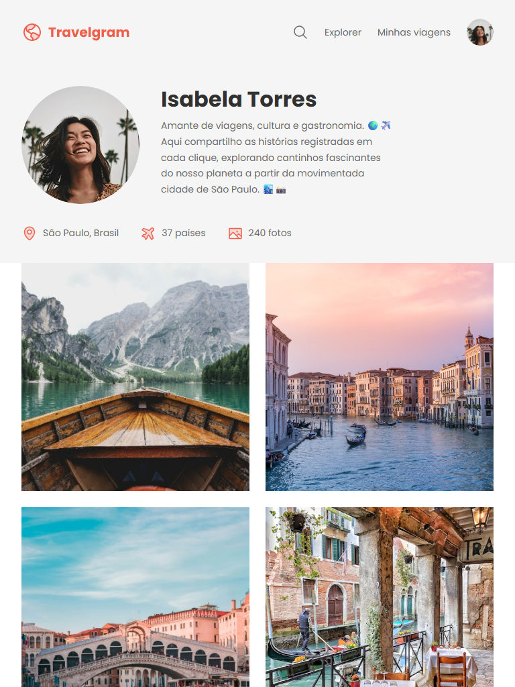
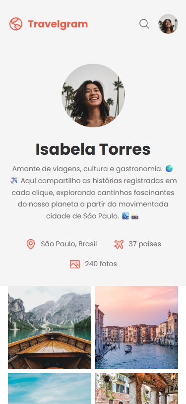

# Travelgram

<p align="center">
  <strong>Página de perfil responsiva de uma rede social de viagens, desenvolvida com HTML e CSS puros.</strong>
</p>

<p align="center">
  
  
  
  
  
</p>

<p align="center">
  <a href="https://montenegroengcomp.github.io/Travelgram/"></a>
</p>

<p align="center">
  <a href="#demonstração-visual">Demonstração visual</a> •
  <a href="#funcionalidades">Funcionalidades</a> •
  <a href="#responsividade">Responsividade</a> •
  <a href="#tecnologias">Tecnologias</a> •
  <a href="#estrutura-de-pastas">Estrutura de pastas</a> •
  <a href="#pré-requisitos">Pré-requisitos</a> •
  <a href="#execução">Execução</a> •
  <a href="#decisões-técnicas">Decisões técnicas</a> •
  <a href="#validações-realizadas">Validações realizadas</a> •
  <a href="#autora">Autora</a>
</p>

---

Página de perfil de uma viajante em uma rede social de fotos de viagem.

O projeto foi construído apenas com **HTML semântico** e **CSS**, sem frameworks nem JavaScript, com foco em organização de estilos, design tokens e layout responsivo com Flexbox e CSS Grid.

🔗 **Acesse:** https://montenegroengcomp.github.io/Travelgram/

## Demonstração visual

<p align="center">
  
</p>

<p align="center">
  
  &nbsp;
  
</p>

## Funcionalidades

### Navegação

- Logo, busca, links **Explorer** e **Minhas viagens** e avatar do usuário.
- Destaque na cor da marca ao passar o mouse sobre os links.

### Perfil

- Foto, nome e bio da viajante.
- Informações de viagem com ícones: cidade, quantidade de países visitados e de fotos publicadas.

### Galeria

- 12 fotos de viagem em grid, recortadas em formato quadrado sem distorção.

### Rodapé

- Copyright e links de termos de uso e política de privacidade.

## Responsividade

O layout se adapta a três faixas de largura, com media queries em cada arquivo de seção:

| Faixa | Navegação | Perfil | Galeria | Rodapé |
| --- | --- | --- | --- | --- |
| Desktop (acima de 900px) | Completa | Foto e bio à esquerda, informações à direita | Até 4 colunas | Em linha |
| Tablet (até 900px) | Completa | Informações abaixo da bio, em linha | Colunas automáticas (mín. 240px) | Em linha |
| Celular (até 600px) | Apenas logo, busca e avatar | Centralizado, foto menor | 2 colunas com espaçamento menor | Empilhado e centralizado |

No desktop, com o container de 1280px, a galeria mantém exatamente as dimensões do layout original: 4 colunas de 286px.

## Tecnologias

| Camada | Tecnologia | Versão |
| --- | --- | --- |
| Estrutura | HTML | 5 |
| Estilo | CSS (Custom Properties, Flexbox, Grid, media queries) | 3 |
| Tipografia | Google Fonts — Poppins | 400 e 700 |
| Ícones | SVG | — |

### Design tokens

As cores e estilos de texto ficam centralizados em variáveis no `:root` de [`styles/global.css`](styles/global.css):

| Token | Valor | Uso |
| --- | --- | --- |
| `--brand-color` | `#EF5F4C` | Logo, ícones e hover dos links |
| `--background-color` | `#FFFFFF` | Fundo da página |
| `--surface-color` | `#F5F5F5` | Fundo da navegação e do perfil |
| `--text-color-primary` | `#313131` | Títulos |
| `--text-color-secondary` | `#6C6C6C` | Textos de apoio |
| `--text-lg` | Poppins Bold 32px / 125% | Nome do perfil |
| `--text` | Poppins Regular 16px / 150% | Texto base |
| `--text-md` | Poppins Regular 14px / 170% | Corpo da página |
| `--text-sm` | Poppins Regular 12px / 170% | Textos pequenos |

## Estrutura de pastas

```text
.
├── assets/
│   ├── icons/              # Ícones SVG (busca, localização, avião e imagem)
│   ├── images/             # Fotos da galeria
│   ├── Logo.svg
│   └── Profile pic.png
├── docs/                   # Capturas de tela usadas no README
├── styles/
│   ├── index.css           # Ponto de entrada: importa os demais arquivos
│   ├── global.css          # Reset, design tokens e classes utilitárias
│   ├── nav.css             # Barra de navegação
│   ├── header.css          # Perfil e informações de viagem
│   ├── main.css            # Galeria de fotos
│   └── footer.css          # Rodapé
└── index.html
```

## Pré-requisitos

- Um navegador atualizado (Chrome, Edge, Firefox ou Safari)
- [Git](https://git-scm.com/), para clonar o repositório
- [VS Code](https://code.visualstudio.com/) com a extensão [Live Server](https://marketplace.visualstudio.com/items?itemName=ritwickdey.LiveServer) (opcional)

O projeto não tem dependências nem etapa de build.

## Execução

O projeto está publicado no GitHub Pages: https://montenegroengcomp.github.io/Travelgram/

Para executar localmente, clone o repositório:

```bash
git clone https://github.com/MontenegroEngComp/Travelgram.git
cd Travelgram
```

Depois, escolha uma das opções:

- Abra o arquivo `index.html` diretamente no navegador; ou
- No VS Code, clique com o botão direito em `index.html` e selecione **Open with Live Server**, para recarregar a página automaticamente a cada alteração.

## Decisões técnicas

- **Design tokens em Custom Properties**: cores e tipografia são definidas uma única vez no `:root`, e o restante do CSS só referencia as variáveis.
- **Shorthand `font` em variáveis**: cada estilo de texto (peso, tamanho, altura de linha e família) é guardado em uma única variável, como `--text-lg: bold 32px/125% var(--font-family)`.
- **CSS modular**: um arquivo por seção da página, todos importados por [`styles/index.css`](styles/index.css). As media queries ficam junto do estilo da seção que alteram.
- **Grid fluido na galeria**: `repeat(auto-fill, minmax(240px, 1fr))` define o número de colunas pela largura disponível, sem media query, e reproduz as 4 colunas de 286px do layout no desktop.
- **Imagens quadradas sem distorção**: `aspect-ratio: 1` com `object-fit: cover` mantém as fotos quadradas em qualquer largura.
- **Propriedades lógicas**: uso de `padding-inline`, `padding-block` e `margin-inline`, com uma classe `.container` reutilizável que limita o conteúdo a 1280px e centraliza a página.
- **HTML semântico**: `nav`, `header`, `main` e `footer` estruturam a página, e todas as imagens têm texto alternativo.

## Validações realizadas

| Validação | Resultado |
| --- | --- |
| Renderização em 1440px (desktop) | Layout original preservado, galeria com 4 colunas de 286px |
| Renderização em 768px (tablet) | Informações do perfil abaixo da bio e galeria em 2 colunas |
| Renderização em 375px (celular) | Sem rolagem horizontal; navegação compacta, perfil centralizado e galeria em 2 colunas |

## Autora

**Clarisse Maria Cabral Montenegro**
